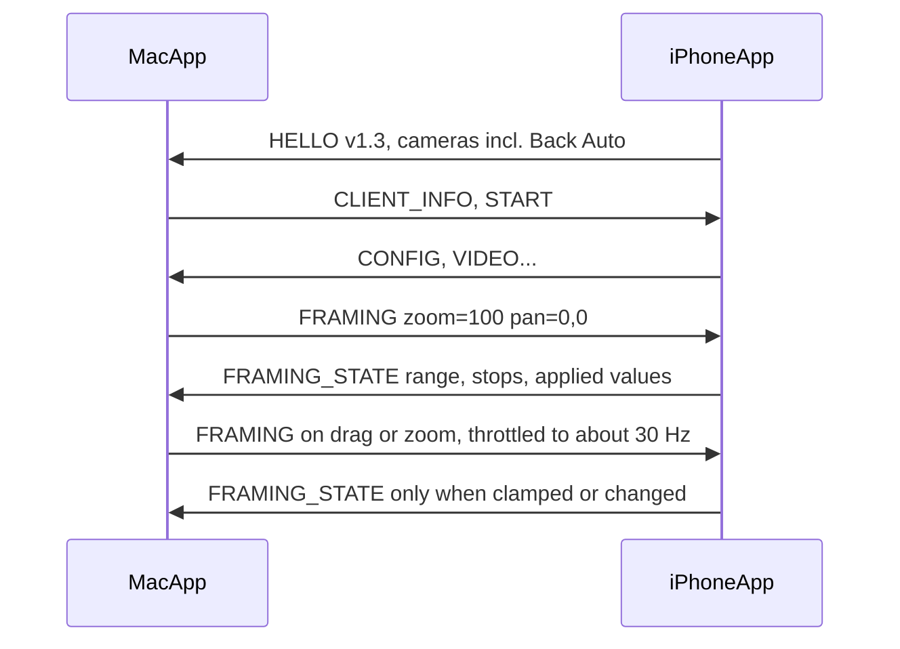

# Remote framing from the Mac

Status: proposal, not implemented. Date: 2026-10-23.

The goal is a Continuity Camera-style framing panel in the TetherCam menu bar window: a live preview, zoom stops plus a slider, drag-to-pan, and Recenter. The Mac sends the framing to the iPhone. The phone applies it while capturing, so the encoded stream is already framed. The Mac does not crop or zoom after the fact.

v1 is zoom and pan. Portrait blur, Center Stage, Studio Light and the other Continuity Camera effects are later, and they belong on the phone for the same reason: the Mac should not spend cycles on a filter the camera can apply before encoding.

## Decisions already made

- Zoom, drag-to-pan and Recenter are in v1. Effects are not.
- The menu bar window shows a small live preview. The Mac app already decodes every frame, so the preview is another consumer of those frames, not a second stream.
- Physical lenses stay as they are. That is the legacy path. A new virtual "Back Auto" camera is what switches lenses as the zoom changes.
- The OBS plugin does not change in v1. It never sends the new message, so it never sees the reply.

## What we can build on

- `MenuBarExtra(...).menuBarExtraStyle(.window)` in `mac-app/App/TetherCamApp.swift` is already a popover. The panel goes into `mac-app/App/MenuBarView.swift`. No new window.
- `HorizonLeveler.process` in `ios-app/Sources/Capture/HorizonLeveler.swift` already rotates, scales and centre-crops in one Core Image pass, usually from a 4K source oversampled down to 1080p. Pan is one extra crop factor and one translation in that transform.
- `CaptureEngine.discover()` lists only physical lenses, in a fixed order, so ids 0 to 3 stay stable. The virtual camera is appended after them.

## Prerequisite: unknown message types

`tools/Sources/IucmProtocol/FrameParser.swift` throws `unknownType` on any message type it does not know. The Mac app's `Receiver` treats that as a framing error and reconnects. That contradicts `protocol/PROTOCOL.md` section 2, which says unknown types are skipped by `length`.

Two consequences:

- Fix the parser so unknown types are skipped, and add a test.
- Mac app 0.4.0 and older `usbcam-recv` builds still have the bug. The phone may therefore send the new app-to-Mac message only to a receiver that has itself sent `FRAMING` on that connection.

## Protocol 1.3

`protocol/PROTOCOL.md` changes first. HELLO version becomes `0x0103`. The Mac shows the panel only when the minor version is at least 3.

`0x05 FRAMING`, Mac to app. Values are absolute, so the message is idempotent and a dropped drag sample does no harm.

| Field | Type | Meaning |
|---|---|---|
| `zoom_x100` | u16 | Display zoom. 50 is 0.5x, 100 is 1x. |
| `pan_x`, `pan_y` | i16 | Each -10000..10000, a fraction of the pan travel currently available. |
| `flags` | u8 | Bit 0 = recenter. |

The phone clamps every value.

`0x15 FRAMING_STATE`, app to Mac. Sent in reply to the first `FRAMING`, again whenever a value is clamped or changed, and on every camera switch.

| Field | Type | Meaning |
|---|---|---|
| `zoom_x100` | u16 | Zoom actually applied. |
| `min_zoom_x100`, `max_zoom_x100` | u16 | Range for the slider. |
| `pan_x`, `pan_y` | i16 | Pan actually applied. |
| `flags` | u8 | Bit 0 = framing available. Bit 1 = pan available. |
| `stop_count` + stops | u8, then N x u16 | Lens stops, for example 50 / 100 / 200 / 500, drawn as the 0.5x / 1x / 2x buttons. |

Lifetime: the phone resets framing to neutral on disconnect, so an OBS session never inherits a zoom left over from the Mac app. The Mac app re-sends its last framing after every START.

Changing zoom or pan never changes the output geometry, so it never triggers a new CONFIG.

## iPhone

Codec and state machine. Add `.framing` and `.framingState` to `ios-app/Sources/Protocol/IucmMessage.swift`. In `ServerStateMachine`:

- A `.framing` message emits `.applyFraming` and marks the connection as framing-capable.
- Teardown and `connectionClosed` emit `.resetFraming`.
- `UsbServer` sends `FRAMING_STATE` only to a framing-capable connection.

Back Auto. In `CaptureEngine.discover()`, append `builtInTripleCamera`, falling back to `builtInDualWideCamera` and `builtInDualCamera`, position back, name `Back Auto`, as the last entry. The phone's lens picker (`CameraCycle`) lists it automatically. Zoom works on every camera. Only Back Auto switches lenses, through `virtualDeviceSwitchOverVideoZoomFactors`. Display zoom maps to the device factor through `displayVideoZoomFactorMultiplier`.

`FramingMath`, a pure type next to `LevelerMath`, unit-tested without a camera. It splits the user's zoom `Z` into a device zoom (the image signal processor) and a GPU crop `c = clamp(Z / Zmin, 1, H)`, with device zoom `Z / c`. `H` is the pan headroom, about 1.5. At the widest setting there is no pan, which matches Continuity Camera. It also computes how far the pan can travel for a given crop, roll angle and aspect ratio, so the output stays covered.

`CaptureEngine`:

- `setFraming(_:)` sets the device zoom with `ramp(toVideoZoomFactor:withRate:)`.
- On every frame, the crop is recomputed from the device's current `videoZoomFactor`, so the total zoom stays smooth while the ramp runs.
- The GPU-pass gate widens from "levelling on" to "levelling on, or framing is not neutral". Oversampling follows the same gate.

`HorizonLeveler.process` takes the crop and the pan offset and adds them to the existing affine transform. Tests check that the output stays covered at the pan clamps and at a 45-degree roll.

## Mac

`tools/Sources/IucmProtocol` gets the two messages, the codec tests, and the parser fix above.

`Receiver`:

- A thread-safe `setFraming(_:)` wakes the receiver thread through the existing wake pipe, so a drag does not wait for the 100 ms poll.
- `FRAMING` goes out only when HELLO minor is at least 3 and a START is already out.
- `onFramingState` reports the phone's state.

`CameraPipeline` passes `setFraming` and `onFramingState` through, and adds an `onPreviewFrame` tap that is active only while the panel is visible.

`AppState` publishes the framing state, keeps the desired framing in memory and in UserDefaults, and re-sends it on each START.

A new `FramingPanel` view sits at the top of `MenuBarView` while the link is streaming:

- Preview through an `AVSampleBufferDisplayLayer`.
- Zoom stop buttons from `FRAMING_STATE`, plus a slider.
- Drag on the preview pans. A trackpad pinch zooms.
- Recenter appears once pan or zoom differs from neutral.
- A phone app older than 1.3 gets one line instead: "Update TetherCam on the iPhone to control zoom".

## Verification

- `swift test --package-path tools` covers the codec and the unknown-type skip.
- `swift test --package-path mac-app/Core` covers the gating and the state callback.
- The iOS test suite covers `FramingMath`, the leveller transform, and the state-machine rules: send only to framing-capable peers, reset on disconnect.
- `usbcam-sim` answers `FRAMING` with a clamped `FRAMING_STATE`. `usbcam-recv --zoom 2.0` sends one. `tools/integration.sh` gets one case.
- Manual check on a real iPhone during a call: zoom from 0.5x to 5x and watch the lenses switch without black frames; drag, then Recenter; disconnect and reconnect and confirm the framing comes back.

## Later

- Center Stage is controllable by the app (`centerStageControlMode = .app`), but only on cameras that support it, mostly the front camera.
- Portrait blur on iOS is a Control Center setting. There is no public API to turn it on from the app. Doing it on the phone means our own person segmentation plus a blur in the same GPU pass.
- Both would reuse the capability flags on `FRAMING_STATE`.

## Trade-offs

- Pan headroom delays lens switching. With `H = 1.5`, the tele lens takes over at 1.5 times its native switch-over point, for example 7.5x instead of 5x. A desk webcam rarely reaches that, but it is a real cost. `H` is one constant in `FramingMath`.
- The GPU pass also runs when horizon levelling is off but framing is in use. Levelling is on by default, so the common case costs nothing extra.
